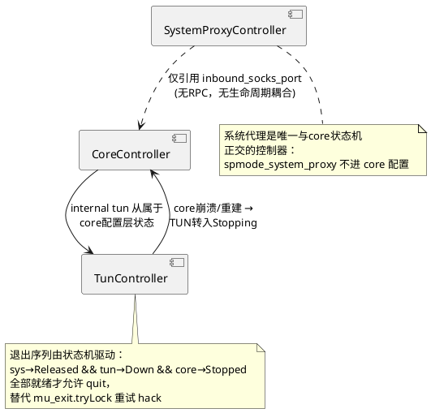

参见
https://deepwiki.com/search/stl_8d7e8807-a74e-4998-96b0-beb8872f7023

## 附录：三控制器协作关系  
  

### 落地要点  
  
- UI 层只发 `enableRequest()`/`stopRequest()` 意图事件，控制器用信号广播状态，`refresh_status` 为纯渲染；  
- `MW_dialog_message("CoreStarted,"+id)` 等字符串协议全部替换为类型化状态事件，CoreProcess 不再直接命令 MainWindow；  
- 每个 `Starting`/`Stopping` 态的超时作为状态内 timer 建模，消掉散落的 `setTimeout`/`MessageBoxTimer`；  
- 三个控制器启动时各自 reconcile 一遍（core 端口占用、TUN/iptables 残留、系统代理指纹），把"崩溃残留"变成一等工作流。

