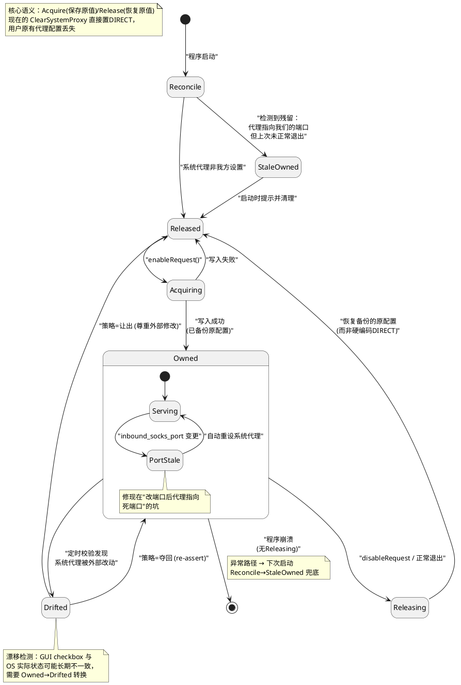

设计目标：将当前散落在各处的零乱隐式状态代码，收敛为显式状态机。UI 层只发送意图事件（`enableRequest()`/`stopRequest()`），控制器持有状态并通过信号广播。
  
---  

## 系统代理占有权（SystemProxyController）  
  
### 设计动机  
  
词眼是"占有权"（ownership）——要回答的不是"代理开没开"，而是"**当前 OS 里的这份代理配置是谁的**"。现有代码把问题压成一个 `spmode_system_proxy` bool，大量边界情况无处安放：写入前不备份原值、外部篡改无感知、崩溃残留无人清理。  
  
### 状态图  
  

  
### 状态说明  
  
| 状态 | 含义 | 对应现有代码 |  
|---|---|---|  
| `Reconcile` | 启动自检：OS 里代理设置现在是什么内容 | 现在没有——启动只看 `remember_spmode`，不看 OS 实际状态 |  
| `StaleOwned` | 系统代理指向我们的端口，但上次未正常退出——上个进程尸体留下的设置 | 现在无处理：崩溃后代理指向死端口，浏览器全部断网 |  
| `Released` | 我们不占有系统代理（OS 是 DIRECT 或他人配置） | `spmode_system_proxy=false` |  
| `Acquiring` | 正在写入系统代理，且**写入前已备份用户原配置** | 现在只有 `SetSystemProxy()`，无备份动作 |  
| `Owned`（复合） | 我们占有系统代理，OS 内容由我们写入 | `spmode_system_proxy=true` |  
| `Owned/Serving` | 正常运行：代理指向当前有效的 `127.0.0.1:inbound_socks_port` | — |  
| `Owned/PortStale` | 占有关系在，但指向端口已失效（用户改了 inbound 端口） | 现存坑：改端口后无人重设系统代理 |  
| `Drifted` | flag 显示占有中，但 OS 实际内容被外部改了（别的代理软件抢占、用户手动改） | 无法表达——checkbox 与 OS 状态悄悄分叉 |  
| `Releasing` | 退出占有中：恢复备份的原配置 | 现在的 `ClearSystemProxy()` 是硬编码置 DIRECT，无恢复语义 |  
  
### 转换说明 

**启动自检（新增核心）**  
  
- `[*] → Reconcile`：程序启动即检查 OS 代理内容。  
- `Reconcile → Released`：OS 代理非我方所写，正常起步。  
- `Reconcile → StaleOwned`：OS 代理指向 `127.0.0.1` 且端口正是上次用的 `inbound_socks_port`，但记录显示上次未正常退出。判定依据："地址恰好是我们端口"这一指纹基本排除巧合。场景：崩溃/强杀后 `on_menu_exit_triggered` 的清理未执行，用户重启电脑发现所有浏览器断网——此类软件最常见的投诉。  
- `StaleOwned → Released`：清除（恢复 DIRECT 或上次备份），可顺手提示"检测到上次异常退出留下的系统代理，已清除"。  
  
**获取占有**  
  
- `Released → Acquiring`：用户勾选系统代理。  
- `Acquiring → Owned`：写入成功。关键动作在转换上：写入前先读出并保存 OS 现有配置（原代理地址、绕过列表、PAC URL），再写入自己的——Acquire 语义。`__QueryProxyOptions` 已会读当前值，只是读了没存。  
- `Acquiring → Released`：写入失败（`InternetSetOption` 失败、gsettings 不存在等）。现在对失败只 LOG 不改 flag，会造成隐式 Drifted。  
  
**占有期间内部转换**  
  
- `Serving → PortStale`：用户改 `inbound_socks_port`（改端口需重启 core 生效）。占有关系没变，但 OS 里的旧端口已无人监听。  
- `PortStale → Serving`：自动用新端口 re-assert。修复现在的坑——端口变更后系统代理指向死端口且无补偿逻辑。  
  
**漂移检测（新状态）**  
  
- `Owned → Drifted`：定时校验（如随 `refresh_status` 或低频 timer）发现 OS 内容不等于我们写入的值。场景：另一个代理软件后写覆盖、用户自己在系统设置里改了代理。现在代码对此完全失明。  
- `Drifted → Owned`：策略"夺回"——重新写入。  
- `Drifted → Released`：策略"让出"——尊重外部修改，复位 flag、取消勾选。这是应暴露给用户的策略选择（"系统代理被外部修改时：提示/夺回/让出"），状态图逼着把决策点显式化。  
  
**释放占有**  
  
- `Owned → Releasing`：用户取消勾选或正常退出（`on_menu_exit_triggered` 的调用即此条）。  
- `Releasing → Released`：完成，动作是"恢复 Acquire 时备份的原配置"而非一刀切置 DIRECT。用户开 nekoray 前的公司代理应被还原。  
  
**异常退出**  
  
- `Owned → [*]`：崩溃，`Releasing` 没机会跑。这不是普通转换，是状态遗留——下次启动 `Reconcile → StaleOwned` 即其兜底闭环。占有权模型下，任何 `Owned` 的非正常终结都必须能被下次启动识别回收。  
  
### 与 CoreController 的关系  
  
此控制器与 CoreController **完全解耦**，这是设计正确性的验证：  
  
- CoreController 不知道系统代理存在（core 配置里没有 `spmode_system_proxy`）；  
- SystemProxyController 不调 core 任何接口，唯一耦合点是读 `inbound_socks_port`（写入目标）和监听端口变更事件（触发 `PortStale`）；  
- core 崩溃/重启，本状态机纹丝不动——只要端口没变，占有依然有效。  
  
退出序列中的角色：`Released` 是三个退出前置条件之一（`sys→Released && tun→Down && core→Stopped` 才允许 quit）。即使 `Releasing` 失败，残留也有下次启动的 `StaleOwned` 兜底。  
  
### 解决的问题  
  
1. **恢复而非清空**：Acquire 备份 / Release 恢复，不再吞掉用户原有代理配置；  
2. **崩溃残留闭环**：崩溃 → `StaleOwned` → 下次启动清理，"崩溃后断网"自动自愈；  
3. **漂移可见**：GUI 与 OS 状态分叉成为显式状态，配合用户可配置策略；  
4. **参数失效自愈**：端口变更在 `Owned` 内触发 re-assert，修掉死端口问题。  
  
---  

