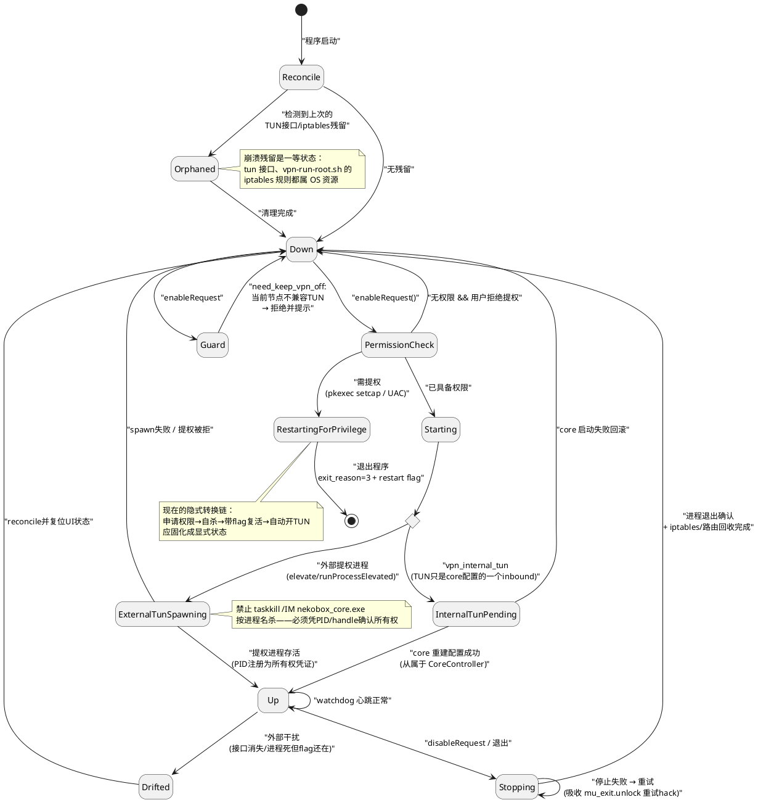

设计目标：将当前散落在各处的零乱隐式状态代码，收敛为显式状态机。UI 层只发送意图事件（`enableRequest()`/`stopRequest()`），控制器持有状态并通过信号广播，`refresh_status` 退化为纯渲染函数。  
  
---  

## TUN 设备生命周期（TunController）  
  
### 设计动机  
  
TUN 模式有两套完全不同的实现：internal（TUN 是 core 配置中的一个 inbound，生命周期从属于 core）和 external（独立的提权子进程）。状态图画的是"TUN 逻辑状态机"，内部用 `mode` 选择点分出两条物理路径。  
  
### 状态图  
  

  
### 状态说明  

| 状态 | 含义 | 对应现有代码 |  
|---|---|---|  
| `Reconcile` | 程序启动自检：上次是否留下 TUN 接口、iptables 规则残留 | 现在完全没有——崩溃后残留无人认领 |  
| `Orphaned` | 检测到上次崩溃/强杀留下的孤儿资源，需回收 | `vpn-run-root.sh` 插的 `iptables -I INPUT` 规则即此类残留 |  
| `Down` | TUN 未启用，干净状态，所有回收路径的终点 | `spmode_vpn=false` 且无 vpn 进程 |  
| `PermissionCheck` | 判断当前进程是否有权限创建 TUN | `!NekoGui::IsAdmin()` 检查 |  
| `RestartingForPrivilege` | 权限不足，需重启整个程序获取权限 | `exit_reason=3` + `on_menu_exit_triggered()` 自杀链 |  
| `Starting` | 权限已具备，进入实际拉起 TUN 阶段 | — |  
| `InternalTunPending` | internal 模式：已请求 core 带 `tun` inbound 重建配置，等待生效 | `BuildConfigSingBox` 的 `tun-in` 段；`neko_set_spmode_vpn` 末尾重启 profile |  
| `ExternalTunSpawning` | external 模式：正在拉起独立提权进程 | `StartVPNProcess` 平台分支（`runProcessElevated`/`pkexec`/`osascript`） |  
| `Up` | TUN 生效中，系统流量被接管 | `spmode_vpn=true` + vpn 进程存活 |  
| `Drifted` | flag 显示开着但实际资源已消失（接口被删、进程被杀） | 现在无法表达：`vpn_pid` 只是整数哨兵，无校验 |  
| `Stopping` | 正在拆 TUN：杀提权进程 + 回收 iptables/路由 | `StopVPNProcess()` |  
| `Guard` | 条件检查点：当前节点与 TUN 不兼容时拒绝开启 | `need_keep_vpn_off` bool + 弹窗 |  
  
### 转换说明  

**启动自检（新增，现在没有）**  
  
- `[*] → Reconcile`：程序启动即做，不问用户。  
- `Reconcile → Down`：环境干净。  
- `Reconcile → Orphaned`：发现残留。场景：上次崩溃或 kill -9，`vpn-run-root.sh` 的 `stop()` 段未执行。  
- `Orphaned → Down`：回收完成（删接口、删 iptables 规则）。  
  
**权限路径（现有代码最绕的一段）**  
  
- `Down → PermissionCheck`：用户勾选 TUN。  
- `PermissionCheck → Down`：无权限且用户拒绝提权（Windows 弹窗选 No、pkexec 被取消）。  
- `PermissionCheck → RestartingForPrivilege`：无权限但用户同意。Linux 下 pkexec setcap 后**整个程序自行退出**，带 `exit_reason=3` 和重启 flag，由外部拉起后以有权限身份自动开 TUN；Windows 同理（UAC 重启）。必须建模的原因：这条"勾选→弹窗→自杀→带 flag 复活→自动勾选"链靠 `exit_reason` 魔法值和命令行参数隐式传递，任一步断掉用户看到的就是"点了没反应"。  
- `RestartingForPrivilege → [*]`：程序退出，接力棒交给下次启动，复活后自动重放一次意图（`Reconcile → Down → PermissionCheck`）。  
  
**拉起路径（两种实现分叉）**  

- `Starting → mode`（choice）：按 `vpn_internal_tun` 配置分流。  
  
internal 分支：  
- `mode → InternalTunPending`：不拉新进程，让 CoreController 带含 `tun` inbound 的配置重启。关键依赖：此状态实为"等另一个状态机（ConfigRunning）重建完"。  
- `InternalTunPending → Up`：core 重建成功，tun inbound 生效。  
- `InternalTunPending → Down`：core 启动失败，回滚 `spmode_vpn`——不能让 UI 显示"TUN 开着"而实际没有。  
  
external 分支：  
- `mode → ExternalTunSpawning`：拉起提权子进程。  
- `ExternalTunSpawning → Up`：进程存活且**将 PID 登记为所有权凭证**。修复现在的 `taskkill /IM nekobox_core.exe` 按名杀问题——Up 必须持有可验证身份（PID/handle），而非 `vpn_pid=1` 占位符。  
- `ExternalTunSpawning → Down`：spawn 失败、提权被拒、进程立刻退出。  
  
**运行期**  
  
- `Up → Up`（自环）：watchdog 心跳确认——external 查提权进程，internal 查 core。  
- `Up → Drifted`：心跳发现资源消失。场景：用户手动 `killall nekobox_core`、网管工具删接口。现在 external 模式靠 `QProcess::stateChanged` 回调 `neko_set_spmode_vpn(false)` 能兜住一部分，internal 和 iptables 残留没人管。  
- `Drifted → Down`：reconcile 清残留、复位 UI。重点：让用户看到"TUN 异常断开"，而非 checkbox 悄悄变回。  
  
**关闭路径**  

- `Up → Stopping`：用户取消勾选或程序退出。  
- `Stopping → Down`：三件事全完成才算完——提权进程退出确认、iptables/路由回收、`vpn_pid` 归零。  
- `Stopping → Stopping`（自环）：停止失败重试。吸收 `on_menu_exit_triggered` 里 `mu_exit.unlock() // retry` 的 hack。  
  
**守卫**  
  
- `Down → Guard → Down`：`need_keep_vpn_off` 时拒绝并提示"先停节点，开 TUN，再重连"。现为孤立 if，建模后是 `enableRequest` 上的前置条件，与权限检查同级。  
  
### 解决的问题  
  
1. **两种实现统一接口**：internal"等 core"与 external"拉进程"差异巨大，但对上层（UI、退出流程）都只是 `Down → Up → Down`。控制器间用事件协作，不再直接互调函数。  
2. **残留资源显式化**：`Orphaned` 和 `Drifted` 把"非正常退出的烂摊子"作为一等状态处理，不再依赖用户手动 `iptables -D`。  
3. **权限重启链固化**：最反直觉的"开 TUN 要重启程序"流程变成图上可读路径。  
4. **退出序列确定化**：TUN 必须走到 `Down` 才允许退出，替代 tryLock 碰运气。  
  
---  

