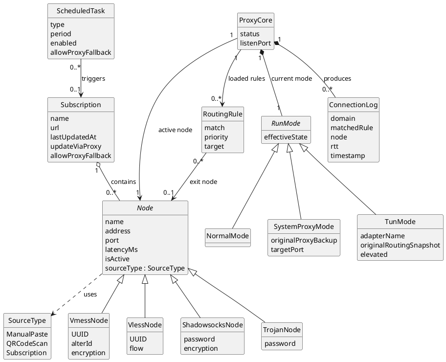
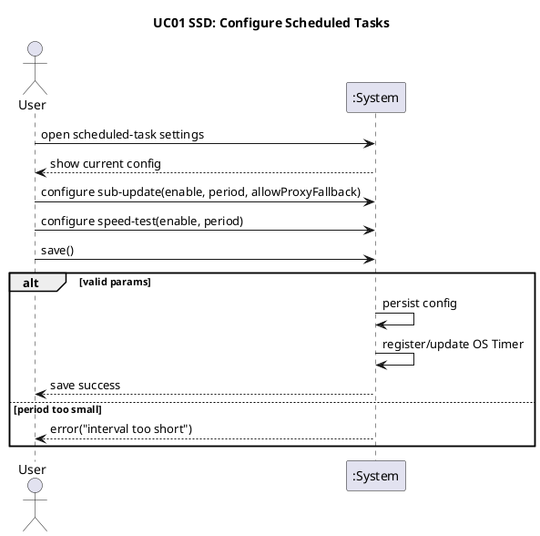
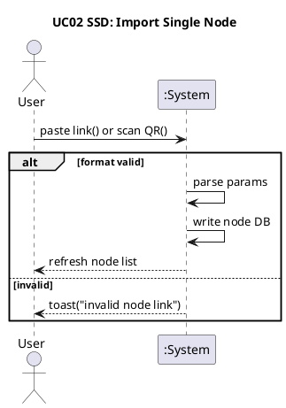
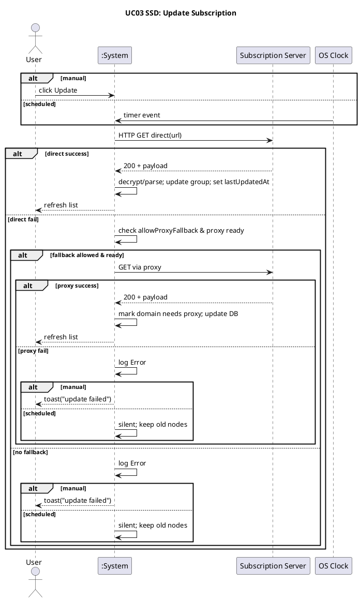
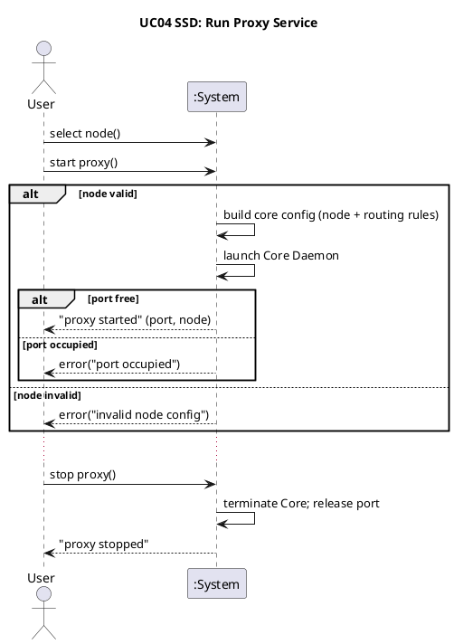
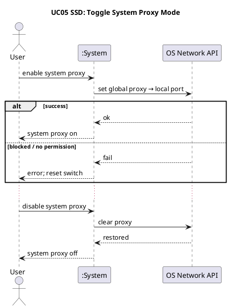
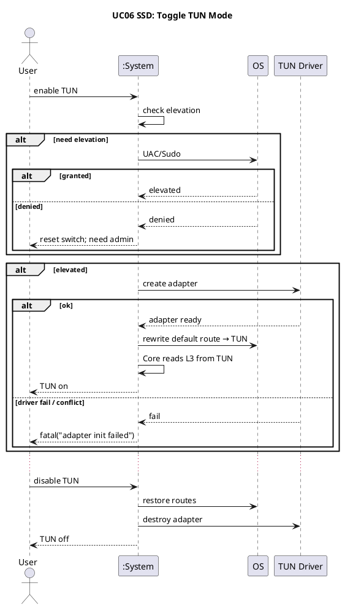
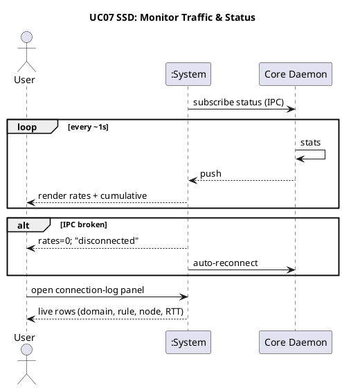
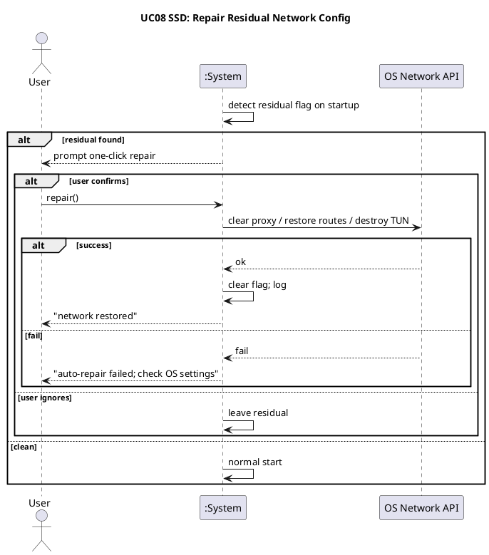
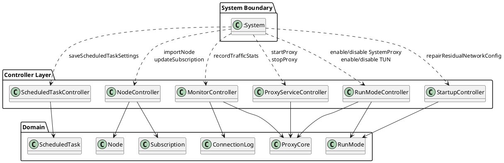

# NekoRay Proxy Client — UML Design Condensed (Phase 1)

> Extracted from prior modeling session. Use this as the single source of truth to continue design (GRASP → Design Class Diagram → Design Sequence Diagrams, etc.).

---

## 1. Scope & Assumptions

- Desktop single-user proxy client (rewrite inspired by open-source NekoRay).
- Core capabilities: node/subscription management, scheduled tasks, proxy core lifecycle, System Proxy mode, TUN mode, traffic monitoring, residual network config repair on startup.
- Design follows Larman *Applying UML and Patterns*: Use Cases → SSD → Domain Model → Operation Contracts → Controllers → GRASP responsibility assignment.
- Domain Model stays pure (business concepts only). Pure Fabrication / Gateway / Repository classes appear only in the design layer.

---

## 2. Use Case Text (8 UCs)

### UC01: Configure Scheduled Tasks
- **Primary actor**: User  
- **Secondary**: OS Clock / Timer Service  
- **Preconditions**: Client running.  
- **Postconditions**: Automation params persisted; OS timer registered/updated.  
- **Main success**:
  1. User opens scheduled-task settings.
  2. Configure subscription auto-update (enable, period, allow-proxy-fallback).
  3. Configure node speed-test (enable, period).
  4. Save.
  5. Persist to local JSON/YAML.
  6. Register/update OS Timer wake events.
- **Extensions**: Illegal period → block save, highlight error.

### UC02: Import Single Node
- **Primary**: User  
- **Preconditions**: None.  
- **Postconditions**: New node record in local DB; UI refreshed.  
- **Main success**:
  1. User pastes link (`vmess://` / `vless://` / `ss://` …) or scans QR.
  2. Validate & parse (address, port, protocol, UUID…).
  3. Write to node DB.
  4. Refresh UI list.
- **Extensions**: Invalid format → toast “invalid node link”, no write.

### UC03: Update Subscription
- **Primary**: User  
- **Secondary**: OS Clock, Subscription Server  
- **Preconditions**: Network available; valid subscription URL configured.  
- **Postconditions**: Subscription group nodes updated; `last_updated_at` set; UI refreshed.  
- **Main success**:
  1. Trigger: manual “Update” or OS Clock (depends on UC01).
  2. Direct HTTP/HTTPS GET to subscription URL.
  3. 200 OK + Base64/YAML payload.
  4. Decrypt/parse node list; overwrite/update local subscription group.
  5. Set `last_updated_at = NOW()`.
  6. Refresh UI.
- **Extensions** (direct fail → proxy fallback):
  - Check “allow proxy fallback” + proxy service ready (UC04).
  - Retry via proxy tunnel.
  - On success: remember domain needs proxy; continue 3–6.
  - Total fail: log error; toast if manual, silent if scheduled; keep old nodes.

### UC04: Run Proxy Service
- **Primary**: User  
- **Secondary**: Target proxy server, target site servers  
- **Preconditions**: At least one active node selected; Core Daemon binary present.  
- **Postconditions**: Local inbound port (Socks5/HTTP) listening; traffic forwarded per routing rules.  
- **Main success**:
  1. User selects node + starts proxy (or mode switch triggers start).
  2. Read active node + routing rules (GeoIP/GeoSite); build core config.
  3. Launch Core Daemon; bind local port (e.g. 127.0.0.1:10808).
  4. App traffic goes to local inbound.
  5. User stops → terminate Core, release port.
- **Extensions**:
  - Port occupied → error toast.
  - Node param validation fail → “invalid node config”.

### UC05: Toggle System Proxy Mode
- **Primary**: User  
- **Secondary**: OS Network API (WinINET / SystemConfiguration)  
- **Preconditions**: Proxy service running (UC04).  
- **Postconditions**: OS global proxy set or restored.  
- **Main success**:
  1. Enable → call OS API → point HTTP/HTTPS/Socks5 to local port.
  2. Compliant apps (Chrome, Edge…) route through proxy.
  3. Disable → clear OS proxy, restore original.
- **Extensions**: OS API blocked/no permission → toast + reset switch.

### UC06: Toggle TUN Mode
- **Primary**: User  
- **Secondary**: OS Network Stack, TUN driver (Wintun/utun)  
- **Preconditions**: Admin/Root; proxy service running (UC04).  
- **Postconditions**: Virtual adapter created; routing table rewritten; L3 traffic captured.  
- **Main success**:
  1. Enable → check elevation (UAC/Sudo if needed).
  2. Create TUN adapter.
  3. Redirect default route to TUN.
  4. Core reads L3 packets from TUN; DNS + routing.
  5. Disable → restore routes, destroy adapter.
- **Extensions**: User denies elevation; driver/load conflict with other VPN.
- **Constraint**: UC05 and UC06 are typically mutually exclusive / overriding at the same moment.

### UC07: Monitor Traffic & Status
- **Primary**: User  
- **Secondary**: Core Daemon  
- **Preconditions**: Proxy running (UC04).  
- **Postconditions**: UI continuously shows rates, cumulative traffic, connection log.  
- **Main success**:
  1. Core stats throughput & bytes while forwarding.
  2. UI subscribes via IPC (gRPC/WebSocket).
  3. UI renders every ~1 s: ↑/↓ rates, session + cumulative traffic.
  4. User opens connection-log panel → live rows (domain, rule, node, RTT).
- **Extensions**: IPC broken → rates zero, toast, auto-reconnect.

### UC08: Detect & Repair Residual Network Settings on Startup
- **Primary**: System (app itself)  
- **Secondary**: OS Network API  
- **Preconditions**: Previous session crashed/killed; residual system-proxy or TUN/route state left behind.  
- **Postconditions**: OS network state cleaned, or user declined.  
- **Main success**:
  1. On launch detect residual flag.
  2. Prompt user with “one-click repair”.
  3. User confirms → clear system proxy / undo routes / remove TUN adapter.
  4. Log repair; toast success.
- **Extensions**: User ignores; OS API fails (no permission).

---

## 3. Domain Model (Concept Classes + Relations)

### Core classes & attributes

| Class | Kind | Key attributes / notes |
|-------|------|------------------------|
| **Node** (abstract) | Entity | name, address, port, latencyMs, isActive, sourceType : SourceType |
| VmessNode | Entity | UUID, alterId, encryption |
| VlessNode | Entity | UUID, flow |
| ShadowsocksNode | Entity | password, encryption |
| TrojanNode | Entity | password |
| **SourceType** | Enumeration | ManualPaste, QRCodeScan, Subscription |
| **Subscription** | Entity | name, url, lastUpdatedAt, updateViaProxy, allowProxyFallback (suggested), nodeCount |
| **ScheduledTask** | Entity | type (subUpdate / speedTest), period, enabled, allowProxyFallback |
| **RoutingRule** | Entity | match (domain/IP/GeoSite), priority, target (direct/proxy/specific node) |
| **ProxyCore** | Entity | status (Running/Stopped), listenPort |
| **RunMode** (abstract) | Entity | effectiveState (Enabled/Disabled) |
| NormalMode | Entity | — |
| SystemProxyMode | Entity | originalProxyBackup, targetPort |
| TunMode | Entity | adapterName, originalRoutingSnapshot, elevated |
| **ConnectionLog** | Entity | domain, matchedRule, node, rtt, timestamp |

### Relations & multiplicity

- `Subscription "1" o-- "0..*" Node` (aggregation — nodes may become orphans if subscription deleted)
- `ScheduledTask "0..*" --> "0..1" Subscription` (triggers update)
- `RoutingRule "0..*" --> "0..1" Node` (exit node)
- `ProxyCore "1" --> "1" Node` (current active node)
- `ProxyCore "1" --> "0..*" RoutingRule` (loaded rules)
- `ProxyCore "1" *-- "1" RunMode` (composition — **design open point**: if UI allows pre-selecting mode before core starts, demote to association + independent RuntimeConfig)
- `ProxyCore "1" *-- "0..*" ConnectionLog` (composition; heavy storage may be offloaded)
- `Node ..> SourceType` (dependency / used as attribute type)
- `Node <|-- VmessNode | VlessNode | ShadowsocksNode | TrojanNode`
- `RunMode <|-- NormalMode | SystemProxyMode | TunMode`

### PlantUML Domain Model

**Open design point**: If the UI allows “pre-select TUN/SystemProxy while core is stopped”, change `ProxyCore *-- RunMode` to an independent `RuntimeConfig` holding the chosen mode, referenced by association.

---

## 4. System Sequence Diagrams (SSD) — PlantUML

Black-box: only Actor(s) ↔ `:System` (+ external secondary participants). One diagram per UC.

---

## 5. Operation Contracts

Only SSD messages that change domain state. Postconditions use Larman style: instance created/deleted, association formed/broken, attribute modified. Failure paths explicitly “no domain state change”.

### OC1: saveScheduledTaskSettings(subUpdateEnabled, subUpdatePeriod, allowProxyFallback, speedTestEnabled, speedTestPeriod)
- **Cross-ref**: UC01  
- **Pre**: Client running; user in settings UI.  
- **Post**:
  - If periods valid: `ScheduledTask` (sub-update) created/updated; `ScheduledTask` (speed-test) created/updated; persisted; OS timer registered.
  - Else: no domain change.

### OC2: importNode(rawLink, sourceType)
- **Cross-ref**: UC02  
- **Pre**: None.  
- **Post**:
  - If link valid: new Node subclass instance created with parsed attrs; `sourceType` set; **no** Subscription aggregation (standalone).
  - Else: no domain change.

### OC3: updateSubscription(subscriptionId, isManualTrigger)
- **Cross-ref**: UC03  
- **Pre**: Network up; Subscription exists with valid URL.  
- **Post**:
  - On success (direct or proxy): Subscription’s aggregated Nodes replaced/updated; `lastUpdatedAt` = now; optional “needs proxy” flag set.
  - On total failure: no Node/Subscription change (old data kept).

### OC4a: startProxy(nodeId)
- **Cross-ref**: UC04  
- **Pre**: Node exists & core-valid; ProxyCore not running; target port free.  
- **Post**:
  - ProxyCore created/activated; association to active Node established; previous active node cleared; status=Running; listenPort set; association to effective RoutingRule set loaded.

### OC4b: stopProxy()
- **Cross-ref**: UC04  
- **Pre**: ProxyCore running.  
- **Post**: status=Stopped; active-node association broken; composed RunMode destroyed; Core process terminated.

### OC5a: enableSystemProxy()
- **Cross-ref**: UC05  
- **Pre**: ProxyCore running.  
- **Post**:
  - On OS success: SystemProxyMode created (with originalProxyBackup, targetPort); composed under ProxyCore; effectiveState=Enabled.
  - On fail: no domain change.

### OC5b: disableSystemProxy()
- **Cross-ref**: UC05  
- **Pre**: Current RunMode is SystemProxyMode & Enabled.  
- **Post**: composition broken; SystemProxyMode destroyed; OS proxy restored (external side-effect).

### OC6a: enableTunMode()
- **Cross-ref**: UC06  
- **Pre**: ProxyCore running; elevated (or elevation succeeds).  
- **Post**:
  - On success: TunMode created (adapterName, originalRoutingSnapshot, elevated=true); composed under ProxyCore (replacing any prior RunMode); effectiveState=Enabled.
  - On denial/driver fail: no domain change.

### OC6b: disableTunMode()
- **Cross-ref**: UC06  
- **Pre**: Current RunMode is TunMode & Enabled.  
- **Post**: composition broken; TunMode destroyed; routes restored & adapter removed (external).

### OC7: recordTrafficStats(uploadBytes, downloadBytes) [+ optional logConnection(...)]
- **Cross-ref**: UC07  
- **Pre**: ProxyCore running; IPC ok.  
- **Post**: ProxyCore cumulative traffic increased; ConnectionLog instance(s) created and composed under ProxyCore (or handed to store).

### OC8: repairResidualNetworkConfig()
- **Cross-ref**: UC08  
- **Pre**: Residual flag detected; user confirmed.  
- **Post**:
  - On success: residual flag cleared; OS network cleaned (external); repair log recorded.
  - On fail: flag remains; no domain change.

**Suggested refinement**: Move `allowProxyFallback` onto `Subscription` (not only ScheduledTask) so both manual and scheduled update paths share one source of truth.

---

## 6. Controllers (Who Receives System Operations)

**Decision**: Prefer Use-Case / Session Controllers grouped by cohesion, **not** a single Facade (11 operations across 6 domains → Bloated Controller risk). Not one controller per UC either.

| Controller | Operations | Rationale |
|------------|------------|-----------|
| **ScheduledTaskController** | OC1 | Isolated to ScheduledTask |
| **NodeController** | OC2, OC3 | Node + Subscription data ingress |
| **ProxyServiceController** | OC4a, OC4b | Core lifecycle state machine |
| **RunModeController** | OC5a/b, OC6a/b | Shared “replace composed RunMode” logic |
| **MonitorController** | OC7 | High-frequency push path |
| **StartupController** | OC8 | Runs at app entry; different lifecycle |

**Rules**:
- Controllers coordinate only: validate preconditions → delegate to domain / repositories / gateways → return result.
- No business data owned by controllers; no complex rules inside controllers (Information Expert goes to domain).
- Single-user desktop → controllers may be application-lifetime singletons (document this deviation from multi-session Larman examples).

---

## 7. GRASP Responsibility Assignment → Design Classes

### 7.1 Pure Fabrication / technical collaborators (design layer only)

| Class | Responsibility | Why not domain |
|-------|----------------|----------------|
| NodeRepository | CRUD + setActiveNode / clearActiveNode | Collection management across instances |
| SubscriptionRepository | findById, etc. | Same |
| ScheduledTaskRepository | saveOrUpdate + persist | Same |
| RoutingRuleRepository | findEffectiveRules | Same |
| ConnectionLogStore | append / query (volume) | Keep ProxyCore cohesive |
| NodeLinkParser | Parse scheme → dispatch to Node subclass factories | String/protocol parsing |
| SubscriptionFetcher | Direct GET + proxy fallback decision | Network I/O |
| CoreConfigBuilder | Node + rules → core config blob | Serialization detail |
| CoreProcessGateway | port check, launch, terminate | OS process |
| OSNetworkGateway | set/clear system proxy | Platform API (Protected Variations) |
| TunDriverGateway | create/destroy adapter, rewrite routes | Platform API |
| TimerGateway | register/unregister OS timer | Platform API |
| ResidualConfigDetector | detect/clear residual flag | Technical startup concern |
| PermissionElevationGateway | UAC/Sudo (may fold into TunDriverGateway) | Platform |
| Logger | Error / repair logs | Cross-cutting |

### 7.2 Assignment by contract (summary)

**OC1 saveScheduledTaskSettings**  
- Period validity → `Period` / `ScheduledTask` (Expert)  
- Create/update → `ScheduledTaskRepository` (Creator)  
- Configure attrs → `ScheduledTask.configure(...)` (Expert)  
- Persist → Repository (+ ConfigFileStore)  
- OS timer → `TimerGateway`

**OC2 importNode**  
- Parse → `NodeLinkParser` → `VmessNode.fromUri()` / … (Polymorphism)  
- Add → `NodeRepository.add` (Creator)  
- sourceType at construction (Expert)

**OC3 updateSubscription**  
- Lookup → `SubscriptionRepository.findById`  
- Fetch → `SubscriptionFetcher.fetch` (reuse parser)  
- Apply nodes + lastUpdatedAt + proxy-required flag → `Subscription.applyUpdatedNodes(...)` (Expert)  
- UI toast vs silent → NodeController coordination + Logger

**OC4a/b start/stopProxy**  
- Validate node → Node subclass `isValidForCore()` (Polymorphism)  
- Port check / launch / terminate → `CoreProcessGateway`  
- Build config → `CoreConfigBuilder`  
- Create ProxyCore → ProxyServiceController as Creator fallback (not aggregated elsewhere)  
- Active node → `NodeRepository.setActiveNode` / `clearActiveNode`  
- ProxyCore attrs → `markRunning(port)` / `markStopped()`  
- Load rules → `ProxyCore.loadRoutingRules` + RoutingRuleRepository  
- Dispose RunMode → `runMode.disable()` polymorphic

**OC5/6 enable/disable modes**  
- OS/TUN calls → `OSNetworkGateway` / `TunDriverGateway`  
- Create mode instances → `ProxyCore.enableSystemProxyMode()` / `enableTunMode()` (Creator — composition owner)  
- Disable/restore → `ProxyCore.disableRunMode()` + mode’s `restore()` holding backup data (Expert) + Gateway

**OC7 recordTrafficStats**  
- Cumulative → `ProxyCore.addTraffic`  
- Log → `ProxyCore.logConnection` creates ConnectionLog then `ConnectionLogStore.append` (Creator + Pure Fabrication for storage)

**OC8 repair**  
- Detect/clear flag → `ResidualConfigDetector`  
- Restore OS → reuse OSNetworkGateway / TunDriverGateway  
- Log → Logger

### 7.3 Design class method catalogue (ready for Design Class Diagram)

| Class | Layer | Core methods |
|-------|-------|--------------|
| Node (+ subclasses) | Domain | `fromUri()`, `isValidForCore()`, active flag accessors |
| Subscription | Domain | `applyUpdatedNodes(...)`, `markProxyRequired()` |
| ScheduledTask | Domain | `configure(...)` |
| ProxyCore | Domain | `markRunning(port)`, `markStopped()`, `enableSystemProxyMode()`, `enableTunMode()`, `disableRunMode()`, `addTraffic()`, `logConnection(...)`, `loadRoutingRules(...)` |
| RunMode (+ subclasses) | Domain | `disable()`, `restore()` |
| ConnectionLog | Domain | attribute holder |
| NodeRepository | PF | `add`, `findById`, `setActiveNode`, `clearActiveNode` |
| SubscriptionRepository | PF | `findById` |
| ScheduledTaskRepository | PF | `saveOrUpdate`, `persist` |
| RoutingRuleRepository | PF | `findEffectiveRules` |
| ConnectionLogStore | PF | `append`, `query` |
| NodeLinkParser | PF | `parse` |
| SubscriptionFetcher | PF | `fetch` |
| CoreConfigBuilder | PF | `build` |
| CoreProcessGateway | PF | `isPortAvailable`, `launch`, `terminate` |
| OSNetworkGateway | PF | `setProxy`, `clearProxy` |
| TunDriverGateway | PF | `createAdapter`, `restoreDefaultRouting`, `unregisterAdapter` |
| TimerGateway | PF | `registerWakeup` |
| ResidualConfigDetector | PF | `detect`, `clearFlag` |
| Controllers (6) | Controller | receive corresponding system operations; coordinate only |

---

## 8. Open Points / Decisions to Confirm Next Session

1. **RunMode lifecycle**: Keep composition under ProxyCore, or introduce independent `RuntimeConfig` for “mode pre-selected while core stopped”?
2. **allowProxyFallback ownership**: Prefer on `Subscription` (shared by manual + scheduled paths).
3. **ConnectionLog persistence**: In-memory only under ProxyCore, or always via ConnectionLogStore (SQLite / ring buffer)?
4. **Orphan nodes**: When Subscription deleted, keep Nodes (aggregation) or cascade-delete?
5. **Node abstract vs concrete**: Force every node into a protocol subclass, or allow a generic “unparsed” Node?
6. Next recommended steps:
   - Design Class Diagram (PlantUML) with layers: Controller / Domain / Pure Fabrication + dependencies.
   - Design Sequence Diagrams for the hottest paths: `updateSubscription` (fallback), `startProxy`, `enableTunMode`.
   - Optional: state machine for ProxyCore + RunMode.

---

*End of condensed Phase-1 design package.*
