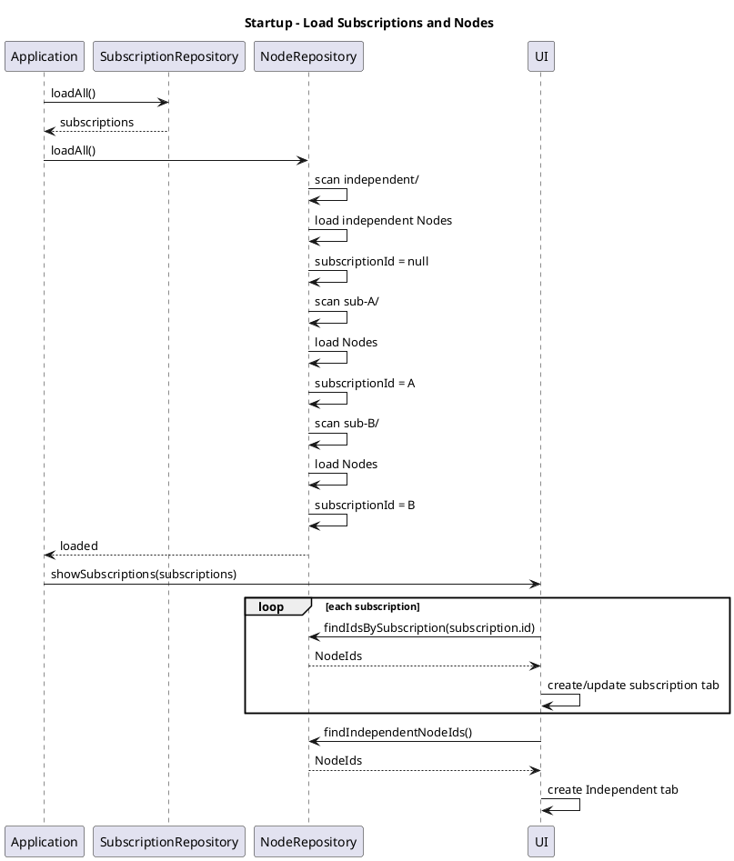
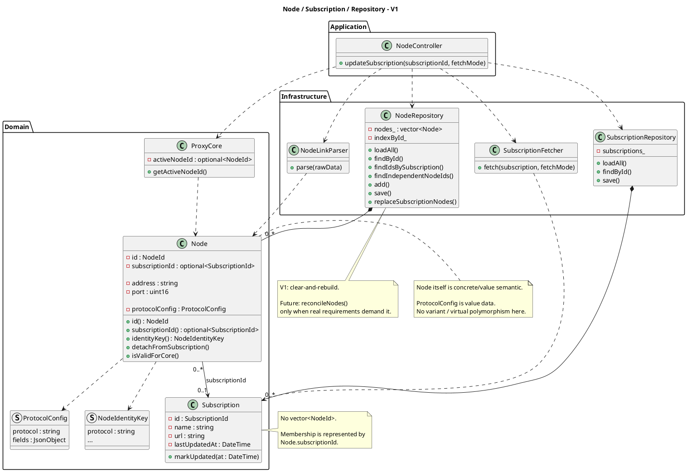

# Neko 项目重构改造 — Subscription Update 阶段设计快照

> 用途：作为长会话迁移/交接文件，供新的 AI session 继续进行 UML → 设计 → C++ 实现。
>
> 本快照只记录**截至本阶段已经讨论并形成共识的内容**，以及明确标记为 V2/V3 的 TODO、未决项。  
> 不把中间草稿、已经放弃的设计、无关功能塞进来。
>
> **当前业务范围严格限定：更新订阅（Update Subscription）。**
> 暂不继续设计 TUN 模式切换、连接日志、其他运行功能。

---

# 1. 项目方法与设计原则

本项目采用：

- UML 驱动的设计流程：用例文本 → System Sequence Diagram → Domain Model → Operation Contracts → GRASP → Design Sequence Diagram → Design Class Diagram → C++ 实现。
- Evolutionary Architecture（演进式架构）。
- YAGNI（You Ain’t Gonna Need It）。
- OCP（Open-Closed Principle）作为长期架构方向：新增功能尽量通过扩展完成，避免为了尚未发生的需求提前引入大量抽象。
- V1 目标：**尽快把最简单、可工作的主流程跑通。**
- 后续复杂能力在已有边界上演进，而不是 V1 一开始就实现。

核心工程取舍：

> 架构上预留未来变化的边界，但 V1 只实现当前真实需要的最简单方案。

典型例子：

- V1 的订阅 Node 更新采用 **clear-and-rebuild**。
- 未来真正需要保留旧 Node、处理集合 diff/reconcile 时，再实现 `reconcileNodes()`。
- V1 不提前实现 Diff Engine、TransactionManager、UnitOfWork、NodeGroup、Strategy Factory 等。

---

# 2. 当前讨论范围

## 当前只讨论

**更新订阅业务逻辑：**

```text
用户发起更新订阅
    ↓
找到 Subscription
    ↓
选择 Direct / Proxy 获取
    ↓
获取原始订阅数据
    ↓
解析为 Node 集合
    ↓
处理当前 Active Node 的保护/迁移
    ↓
替换该 Subscription 下的 Node 集合
    ↓
更新 Subscription.lastUpdatedAt
    ↓
UI 刷新
```

## 当前明确排除

- TUN 单核 / 双核切换
- System Proxy / TUN 等 RunMode 细节
- ConnectionLog
- 流量统计
- 其他运行时功能

这些前序设计可以作为历史上下文，但本阶段不继续扩展。

---

# 3. 核心领域关系

## 3.1 Subscription

`Subscription` 表示：

> 一个订阅本身及其订阅配置/状态。

V1 主要属性：

```cpp
SubscriptionId id;
std::string name;
std::string url;
DateTime lastUpdatedAt;
```

职责：

- 保存自己的业务状态。
- `markUpdated(at)` 更新订阅时间。

**Subscription 不持有具体 Node 对象。**

也**不保存 `std::vector<NodeId>`**。

原因：

如果 Subscription 保存 NodeId，而 Node 又保存 `subscriptionId`，就会产生两份 membership truth：

```text
Subscription.nodeIds
Node.subscriptionId
```

一旦 detach / replace 时只修改其中一处，就会出现不一致。

因此 V1 采用：

> **Node.subscriptionId 作为 Node → Subscription membership 的唯一关系来源。**

UI 按 Subscription 建 Tab，不意味着 Domain 中 Subscription 必须反向拥有 Node 集合。

---

## 3.2 Node

`Node` 表示具体代理节点。

Node 是一个**具体的、值语义的 Domain Entity**，不是抽象基类。

核心数据：

```cpp
NodeId id;
std::optional<SubscriptionId> subscriptionId;

std::string address;
uint16_t port;

ProtocolConfig protocolConfig;
```

其中：

- `NodeId`：持久化对象身份。
- `subscriptionId`：运行时 domain relationship。
- `address` / `port`：Node 数据。
- `ProtocolConfig`：协议相关配置数据。

### NodeId

含义：

> “这是数据库/文件系统中的哪一个 Node 对象？”

采用 UUID。

规则：

- 第一次创建 Node 时生成随机 UUID。
- UUID 是持久化对象身份。
- **不要因为每次重新解析订阅就重新生成相同逻辑 Node 的 ID。**
- UUID 与文件路径解耦。
- 文件位置未来可以变化，而 NodeId 不应该跟着变化。

---

## 3.3 NodeIdentityKey

含义：

> “这次订阅刷新解析出来的 Node，是否还是原来的同一个逻辑节点？”

`NodeIdentityKey` 是：

- **派生值**
- 不作为 Node 持久化成员
- 不单独写 JSON
- 用于将来 Diff / reconcile 时匹配旧 Node 与新 Node

V1 不把所有协议的 identity 规则过早冻结。

曾讨论过：

```text
protocol + address + port
```

可以作为 V1 简单 heuristic，但这个组合**不是已经冻结的最终通用规则**。

例如不同协议可能还有协议特有的身份字段。因此：

```cpp
Node::identityKey()
```

作为统一边界保留即可，具体 identity 规则以后在真正实现 Diff 时再系统确定。

---

# 4. Node 协议设计：当前最终方向

## 4.1 不使用 std::variant 表示 Node 的协议类型

已经明确认为：

```cpp
std::variant<
    VmessConfig,
    VlessConfig,
    AnyTlsConfig,
    ...
>
```

不适合作为 Node 协议的长期模型。

原因：

代理协议集合是**开放集合**：

```text
Vmess
Vless
Trojan
Shadowsocks
AnyTLS
...
未来还可能继续出现新协议
```

如果使用 `variant`，新增协议通常必须修改：

```cpp
using ProtocolConfig = std::variant<...>;
```

并可能修改相关 `std::visit` visitor。

这不符合本项目希望的 OCP 方向。

---

## 4.2 ProtocolConfig 使用值语义

本阶段最新结论：

> `ProtocolConfig` 本身只是协议配置数据，不需要虚函数做多态，因此不使用 `unique_ptr`、继承或 `clone()`，而使用值语义。

推荐的 V1 方向：

```cpp
struct ProtocolConfig
{
    std::string protocol;
    JsonObject fields;
};
```

实际 JSON 类型可依据项目 Qt/C++ 环境选择，例如 Qt 中可以是 `QJsonObject`。

含义：

- `protocol` 表示协议名称。
- `fields` 保存该协议的 JSON 配置字段。
- 新增协议可以作为新的 `protocol` + `fields` 数据出现。
- 不需要修改 `Node` 的成员定义。

因此 Node：

```cpp
class Node
{
private:
    NodeId id_;
    std::optional<SubscriptionId> subscriptionId_;

    std::string address_;
    uint16_t port_;

    ProtocolConfig protocolConfig_;

public:
    NodeId id() const;
    std::optional<SubscriptionId> subscriptionId() const;

    NodeIdentityKey identityKey() const;
    void detachFromSubscription();

    // ...
};
```

### 注意

本阶段不再采用上一轮曾提出的：

```cpp
std::unique_ptr<ProtocolConfig>
ProtocolConfig::clone()
```

那套方案已放弃，原因就是 V1 当前并没有需要动态多态的行为。

---

# 5. NodeRepository 的对象所有权与内存结构

## 5.1 Repository 持有 live Node 对象

`NodeRepository` 是 Node 的持有者：

```cpp
std::vector<Node> nodes_;
```

而不是：

```cpp
std::vector<std::unique_ptr<Node>>
```

也不是：

```cpp
std::vector<Node*>
```

因为当前 Node 是具体值语义对象。

这样 Node 对象本身可以连续存放于 vector 中。

---

## 5.2 NodeRepository 的查找

可以使用：

```cpp
std::unordered_map<NodeId, std::size_t> indexById_;
```

将 NodeId 映射到 `nodes_` 下标。

即：

```text
NodeRepository
    ├── vector<Node>             // 真正拥有 Node
    └── unordered_map<NodeId,...> // lookup index
```

这不是要求最终 C++ 精确照抄这个内部结构，但 V1 的设计方向是：

> Repository 是内存中的 Node collection，同时隐藏 JSON 文件持久化。

---

## 5.3 Node 指针/引用的正确理解

“Node 是值语义”不等于代码里绝对不能出现 `Node*`。

可以暂时获得：

```cpp
Node*
```

或：

```cpp
Node&
```

来访问 Repository 内部已经拥有的 Node，但它们：

- 不拥有 Node
- 不作为长期跨组件身份
- 不能替代 `NodeId`

长期保存/跨对象引用统一使用：

```cpp
NodeId
```

例如：

```cpp
ProxyCore.activeNodeId
UI.selectedNodeId
protectedNodeId
```

都保存 NodeId，而不是 Node*。

这是因为 `std::vector<Node>` 在插入/扩容等情况下可能导致 element address/reference/iterator 失效。

---

# 6. Repository API：V1 方案

当前语义接口：

```cpp
class NodeRepository
{
public:
    void loadAll();

    // 查询
    Node* findById(NodeId id);
    const Node* findById(NodeId id) const;

    std::vector<NodeId>
    findIdsBySubscription(SubscriptionId id) const;

    std::vector<NodeId>
    findIndependentNodeIds() const;

    // 单对象
    void add(Node node);
    void save(NodeId id);

    // 集合操作
    void replaceSubscriptionNodes(
        SubscriptionId subscriptionId,
        std::vector<Node> newNodes,
        std::optional<NodeId> protectedNodeId);
};
```

### 关于 first/last 迭代器

理论上可以写：

```cpp
template<class InputIt>
void replaceSubscriptionNodes(
    SubscriptionId id,
    InputIt first,
    InputIt last,
    std::optional<NodeId> protectedNodeId);
```

因为它可以适配 `vector`、`QVector`、`list`、map 等不同来源。

但是：

> **V1 不采用这一泛化 API。**

原因不是迭代器有问题，而是这个 Repository 方法表达的是一个明确的业务动作：

```text
“用这批新的 Node 替换订阅”
```

而不是通用 STL 算法。

`std::vector<Node>`：

- 可读性更强
- 业务语义更直观
- 当前调用方需求完全够用
- 模板复杂度更低

以后如果真实需求要求支持 generic range，再演进到 C++20 range / iterator API。

不要为了抽象而抽象。

---

# 7. SubscriptionRepository 与 SubscriptionJsonMapper

## V1 不单独增加 SubscriptionJsonMapper

当前判断：

> `SubscriptionJsonMapper` 在 V1 可以省略。

原因：

Subscription JSON 很简单，当前只有一个 Repository 使用这套映射。

Repository 可以直接实现简单 JSON 读写，或在 `.cpp` 内使用私有辅助函数：

```cpp
Subscription readSubscription(...);
JsonObject writeSubscription(...);
```

未来如果出现：

- JSON 格式复杂化
- 多版本 JSON
- migration
- import/export
- 多处复用同一套映射

再提取：

```cpp
SubscriptionJsonMapper
```

这属于后续演进，不属于 V1 必须的类。

### Subscription 文件与目录

目录负责定位对象：

```text
subscriptions/
    <subscription-id>.json
```

JSON 保存 Subscription 自身业务数据：

```text
id
name
url
lastUpdatedAt
...
```

目录不能替代全部 Subscription 属性，因为目录通常只能用于定位 SubscriptionId；名称、URL、更新时间等仍然属于 Subscription 数据。

---

# 8. Node JSON 与 subscriptionId

V1 明确采用：

> **Node JSON 不序列化 `subscriptionId`。**

原因：

订阅 membership 在持久化层由目录位置表达。

推荐目录：

```text
data/
└── nodes/
    ├── independent/
    │   ├── <node-uuid-A>.json
    │   └── <node-uuid-B>.json
    │
    ├── sub-<subscription-id-A>/
    │   ├── <node-uuid-C>.json
    │   └── <node-uuid-D>.json
    │
    └── sub-<subscription-id-B>/
        └── ...
```

对应关系：

```text
Node JSON
    ↓
Node 自身数据

directory location
    ↓
Node 属于哪个 Subscription
```

启动时 Repository 根据目录位置恢复：

```cpp
independent/
    => subscriptionId = nullopt

sub-<id>/
    => subscriptionId = <id>
```

因此：

```cpp
subscriptionId
```

是运行时 domain relationship，不属于 V1 Node JSON。

---

# 9. Independent Group

V1 只有一个：

```text
independent/
```

它表示没有 Subscription 的 Node。

现在不引入：

```cpp
NodeGroup
```

因为目前没有实际需求。

未来如果真的需要：

- 多个 Independent groups
- 用户命名 group
- 拖拽 Node 到不同 group

再演进成 generic group model。

---

# 10. Active Node 规则

Active Node 的运行时“当前是谁”仍属于 `ProxyCore` 的运行状态。

推荐保存：

```cpp
std::optional<NodeId> activeNodeId_;
```

而不是 `Node*`。

Subscription 更新时：

### Active Node 仍然出现在新订阅

如果：

```text
oldActive.identityKey()
==
newNode.identityKey()
```

则：

```text
newNode.id = oldActive.id
```

保持 Active Node 的 NodeId。

### Active Node 从新订阅结果中消失

不要删除它。

执行：

```text
Subscription A
    old Active Node
        ↓
    Independent
```

即“Detach to Independent”。

这是一个明确的 V1 业务规则。

---

# 11. Subscription Update V1：核心流程

V1 主流程：

```text
1. SubscriptionRepository.findById(subId)
2. SubscriptionFetcher.fetch(subscription, fetchMode)
3. NodeLinkParser.parse(rawData)
4. ProxyCore.getActiveNodeId()
5. 如果 Active Node 属于当前 Subscription：
      用 NodeIdentityKey 查找新列表中的对应 Node
      - 找到：把旧 NodeId 赋给新 Node
      - 找不到：设置 protectedNodeId，准备 detach
6. NodeRepository.replaceSubscriptionNodes(...)
7. Subscription.markUpdated(now)
8. SubscriptionRepository.save(...)
9. UI 刷新
```

---

# 12. `replaceSubscriptionNodes()` 的 V1 语义

## 普通情况

旧：

```text
Subscription A
    A1
    A2
    A3
```

新：

```text
B1
B2
```

V1：

```text
删除 A1,A2,A3
写入 B1,B2
```

即：

> **clear-and-rebuild**

---

## Active Node 匹配成功

旧：

```text
A1 = Active
A2
A3
```

新解析：

```text
A1'
A4
```

Controller 通过 `identityKey()` 判断：

```text
A1 == A1'
```

然后：

```text
A1'.id = A1.id
```

Repository 得到：

```text
A1
A4
```

---

## Active Node 消失

旧：

```text
A1 = Active
A2
A3
```

新：

```text
A4
A5
```

Controller：

```text
protectedNodeId = A1
```

Repository 最终：

```text
Subscription A:
    A4
    A5

Independent:
    A1
```

A2/A3 在 V1 中可以直接消失。

这是 clear-and-rebuild 的明确 V1 trade-off。

---

# 13. 为什么 V1 不实现全量 Diff

因为如果现在就：

```text
旧 Node 集合
    ↓
做 identity matching
    ↓
added/removed/modified/unchanged
    ↓
保留所有旧 Node 对象
    ↓
处理用户修改
    ↓
再计算持久化差异
```

软件复杂度会显著提高。

V1 先做：

```text
fetch → parse → 保护 Active → clear/rebuild
```

未来真正需要时再增加：

```cpp
reconcileNodes(...)
```

### V2 TODO

未来 Diff / reconcile 需要回答：

- 如何使用 `NodeIdentityKey` 匹配旧/新 Node
- matched Node 是否保留原 NodeId
- 用户手动修改过的字段是否保留
- added / removed / unchanged / modified 如何处理
- 如何处理协议-specific identity

这些现在不冻结。

---

# 14. NodeRepository 与文件系统持久化

## Domain / Repository / File System 的边界

```text
Domain
    Subscription
    Node

Repository
    内存对象集合
    持久化边界
    查询
    集合替换

File System
    JSON 文件
    目录结构
```

Domain 不应该知道：

```text
data/nodes/
sub-xxx/
independent/
```

这些是 Infrastructure concern。

---

# 15. Startup：从 JSON 加载到内存

程序启动：



关键点：

> JSON 在启动时加载进 Repository 的内存集合；正常 UI 查询不应每次都重新扫描 JSON 文件。

---

# 16. UI 按 Subscription 分 Tab

这是 Presentation concern，不要求 Subscription 保存 NodeId。

概念流程：

```text
Subscription A
    ↓
NodeRepository.findIdsBySubscription(A)
    ↓
NodeId list
    ↓
UI Tab A
```

例如：

```text
Tab: Subscription A
-------------------
HK-01
HK-02
SG-01

Tab: Subscription B
-------------------
JP-01
JP-02

Tab: Independent
----------------
Manual-01
Manual-02
```

UI Model 可以保存：

```cpp
std::vector<NodeId> visibleNodeIds_;
```

而不是保存 `Node*`。

---

# 17. UI 排序

UI 排序属于 Presentation layer。

例如用户点击：

```text
Protocol
```

UI 自己对当前显示的 `NodeId` 顺序进行排序。

例如：

```text
vmess
vmess
vless
trojan
```

或者点击：

```text
Address
```

排序：

```text
HK...
HK...
SG...
SG...
```

Repository 本身不需要因为 UI 排序重新组织 Node 的 storage order。

因此：

```text
NodeRepository
    ↓
“有哪些 Node”

UI Model
    ↓
“以什么顺序显示”
```

保持职责分离。

---

# 18. UI 选择 Node 的原则

UI 长期保存：

```cpp
NodeId selectedNodeId;
```

而不是：

```cpp
Node*
Node&
```

需要操作时：

```cpp
auto node = repository.findById(selectedNodeId);
```

这样 `std::vector<Node>` 的重新分配不会影响业务身份。

---

# 19. Update Subscription 的最终 UML Sequence Diagram

这是当前用于后续会话衔接的主要 UML 成果。

```plantuml
@startuml UpdateSubscription_V1_Frozen
title Update Subscription - V1

actor User
participant UI
participant NodeController as Controller

participant SubscriptionRepository as SubRepo
participant SubscriptionFetcher as Fetcher
participant NodeLinkParser as Parser
participant ProxyCore as Core
participant NodeRepository as NodeRepo

User -> UI : Update subscription
UI -> Controller : updateSubscription(subId, fetchMode)

Controller -> SubRepo : findById(subId)
SubRepo --> Controller : Subscription

Controller -> Fetcher : fetch(subscription, fetchMode)

alt fetch failed
    Fetcher --> Controller : failure
    Controller --> UI : updateFailed
else fetch succeeded

    Fetcher --> Controller : RawData

    Controller -> Parser : parse(rawData)

    alt parse failed
        Parser --> Controller : failure
        Controller --> UI : updateFailed
    else parse succeeded

        Parser --> Controller : newNodes

        Controller -> Core : getActiveNodeId()
        Core --> Controller : activeNodeId / null

        alt active node belongs to this subscription

            Controller -> NodeRepo : findById(activeNodeId)
            NodeRepo --> Controller : activeNode

            Controller -> Controller :
                compare identityKey()

            alt active node matched

                Controller -> Controller :
                    assign existing NodeId
                    to matched newNode

            else active node disappeared

                Controller -> Controller :
                    protectedNodeId = activeNodeId

            end
        end

        Controller -> NodeRepo :
            replaceSubscriptionNodes(
                subId,
                newNodes,
                protectedNodeId
            )

        NodeRepo --> Controller : success

        Controller -> SubRepo :
            save(Sub.markUpdated(now))

        SubRepo --> Controller : success

        Controller --> UI : updateSucceeded

    end
end

@enduml
```

---

# 20. 当前最终 UML / 类设计

用于后续 session 衔接的主要类关系：



---

# 21. Domain 与文件持久化的关系

```plantuml
@startuml DomainPersistenceMapping
title Domain Model / Repository / File System

package "Domain" {
    class Node {
        NodeId id
        optional<SubscriptionId> subscriptionId
        address
        port
        ProtocolConfig
    }

    class Subscription {
        SubscriptionId id
        name
        url
        lastUpdatedAt
    }
}

package "Repository" {

    class NodeRepository {
        vector<Node> nodes_
        unordered_map<NodeId, size_t> indexById_
    }

    class SubscriptionRepository {
        subscriptions_
    }
}

database "File System" as FS

folder "data/nodes/" as NodesDir {
    folder "independent/" as Independent
    folder "sub-<subscription-id>/" as SubscriptionDir
}

NodeRepository *-- Node
SubscriptionRepository *-- Subscription

NodeRepository ..> NodesDir
SubscriptionRepository ..> FS

note right of Independent
Node.subscriptionId = nullopt
end note

note right of SubscriptionDir
Directory location determines
Subscription membership.

subscriptionId is reconstructed
at runtime and is not stored
in Node JSON in V1.
end note

@enduml
```

---

# 22. OCP：当前设计的“开放/封闭”边界

## 新增代理协议

目标：

```text
新增协议
    ↓
主要扩展 NodeLinkParser /
协议解析相关代码
    ↓
Node / Repository / Subscription
不需要跟着增加一个新的 Node 派生类型
```

`ProtocolConfig` 使用：

```text
protocol name + JSON fields
```

因此不要求修改 Node 的成员集合。

未来如果协议解析真的成为变化热点，再演进成更细粒度的 parser registry / protocol parser abstraction。

**V1 不提前实现。**

---

# 23. OCP + YAGNI 的具体原则

不是要求任何地方都“一次抽象到位”。

而是：

```text
稳定业务流程
    +
明确变化边界
    +
最小 V1 实现
```

### 已经留好的边界

- `Node::identityKey()` → future Diff
- `NodeRepository::replaceSubscriptionNodes()` → future reconcile
- `ProtocolConfig` → future protocol extensions
- Repository → future persistence changes
- UI Model → future sort/filter/group changes

### V1 不实现的复杂性

- 全量 Node diff/reconcile
- 多 Independent Group
- TransactionManager / UnitOfWork
- Crash Recovery Manifest
- Fetch Strategy Factory
- SubscriptionJsonMapper
- Protocol parser registry
- 过度泛化的 iterator/range Repository API

---

# 24. 文件操作一致性方面的 V1 范围

订阅 Node replacement 可以先：

1. 创建临时目录
2. 把新 Node JSON 写入临时目录
3. 准备需要 detach 的 Active Node
4. 准备成功后进行目录替换
5. 更新内存集合

如果 preparation 阶段发生普通异常：

> 可以保证旧持久化状态不被提前破坏。

但是：

> **不要声称整个“detach + subscription directory replacement + timestamp save”是完整 ACID / Strong Exception Guarantee。**

特别是：

```text
sub-A/
    ↓
Independent/
```

与：

```text
sub-A/ 新目录替换
```

是跨目录操作。

如果进程在 commit 中间崩溃，可能需要后续恢复机制。

### V1

先不做复杂 crash recovery。

### V2/V3 TODO

真实出现需求后，再设计：

- manifest
- recovery protocol
- 更完整的持久化 transaction boundary

---

# 25. 一个 V1 重要取舍：NodeId 延续范围

V1 使用 clear-and-rebuild，因此：

> **普通旧 Subscription Nodes 的 NodeId 不保证跨刷新保持。**

唯一明确保护的是 Active Node：

### Active Node identity 匹配

保留旧 NodeId。

### Active Node identity 不匹配

旧 Active Node detach 到 Independent，保留旧 NodeId。

### 其他旧 Node

V1 可以直接被清掉，然后新解析出的 Node 使用新的 UUID。

这是为了避免把 V1 偷偷升级成完整 Diff/Reconciliation。

未来 V2 再解决：

```text
所有旧 Node
    ↕ NodeIdentityKey
所有新 Node
```

的全面匹配和 ID 延续。

---

# 26. 用户编辑订阅 Node 的 V1 取舍

目前的 clear-and-rebuild 意味着：

> Subscription refresh 可以覆盖订阅来源的旧 Node 数据。

如果未来业务要求：

> 用户在 UI 手动修改 Subscription Node 后，刷新订阅仍应保留用户修改。

则需要进一步定义：

- 哪些字段来自订阅
- 哪些字段属于本地 override
- 如何 merge
- 如何通过 NodeIdentityKey 找回原对象

这属于 V2+，当前不要预先实现。

---

# 27. 当前设计中明确不要重新引入的东西

以下历史/备选方案已不再作为当前 V1：

```text
Subscription 持有 vector<Node>
Subscription 持有 vector<NodeId>
Subscription 直接知道 NodeRepository
Node JSON 持久化 subscriptionId
Node 使用 std::variant 表示全部代理协议
Node / ProtocolConfig 使用无必要的 unique_ptr + clone
Repository 使用 Node* 作为所有权
RunModeController
markProxyRequired()（V1 已删除）
```

其中：

> `markProxyRequired()` 原本在更早设计中用于记录 proxy fallback 状态，但当前 V1 已明确取消。

V1 的 Direct / Proxy 获取方式由 UI 明确选择。

---

# 28. 下一步任务

## 当前下一步：C++ 类接口定稿

需要继续完成：

### 1. `Node` 的最小 C++20 类定义

需要确定：

- `NodeId` 的具体类型
- `SubscriptionId` 的具体类型
- `ProtocolConfig` 的实际 Qt/C++ 数据类型
- `NodeIdentityKey` 的最小接口
- `Node::detachFromSubscription()`
- `Node::identityKey()`

### 2. `NodeRepository` V1 实现骨架

重点：

```cpp
loadAll()
findById()
findIdsBySubscription()
findIndependentNodeIds()
add()
save()
replaceSubscriptionNodes()
```

包括：

```text
内存集合
JSON 读写
目录扫描
subscriptionId 从目录恢复
clear-and-rebuild
Active Node detach 的持久化执行
```

### 3. `SubscriptionRepository`

保持简单：

```text
loadAll()
findById()
save()
```

V1 不增加 `SubscriptionJsonMapper`。

### 4. `NodeController::updateSubscription()`

把最终时序图真正转成 C++ 伪代码/接口调用。

重点验证：

```text
fetch failure
parse failure
active node match
active node detach
replace failure
subscription timestamp update
```

### 5. 最后再把这套代码骨架与 UML Operation Contract / GRASP 对照

确保：

- Controller 做协调
- Domain 做自身状态
- Repository 做持久化/集合操作
- Fetcher 做获取
- Parser 做解析
- 不让 Repository 偷含业务规则
- 不让 UI 直接碰文件系统

---

# 29. 给新 AI Session 的上下文使用说明

新的 session 应把本文件作为当前阶段的项目状态，而不是重新从零设计。

处理任何后续设计问题时：

1. 以本文件中的“当前定稿 / V1”作为基准。
2. 不要把“V2/V3 TODO”当作已经实现的设计。
3. 不要重新提出本文件已经明确放弃的方案，除非有新的具体理由需要推翻。
4. 如果新讨论确实改变了当前定稿，明确记录：
   - 原设计
   - 新设计
   - 为什么修改
   - 属于 V1 还是 V2+
5. 不要为了所谓 OCP 提前增加没有实际需求的抽象。
6. 当前仍然只讨论 Subscription Update，不扩展到 TUN、日志等其他业务。

